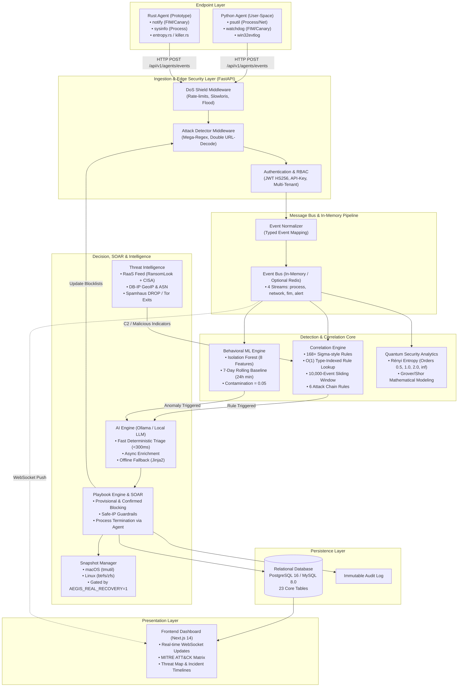
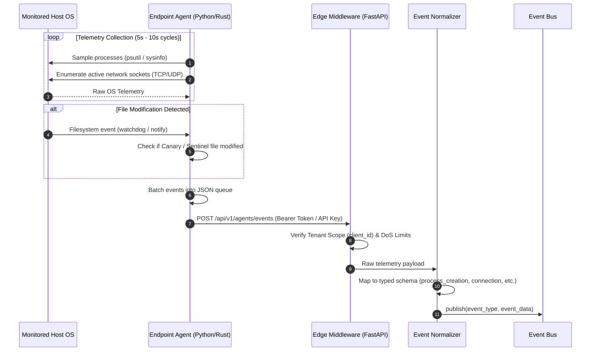
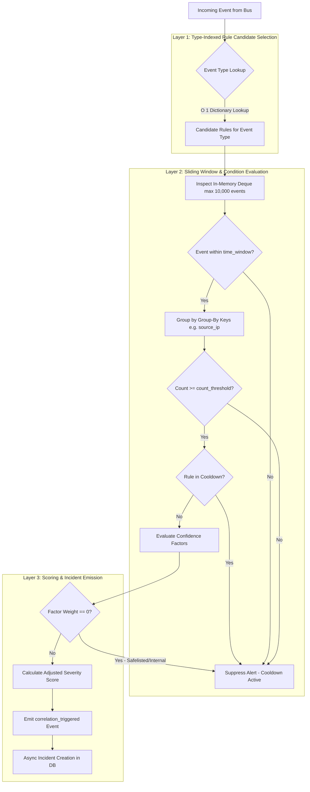
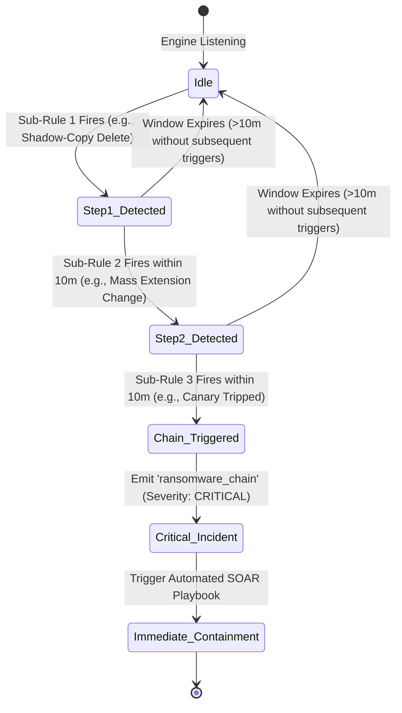
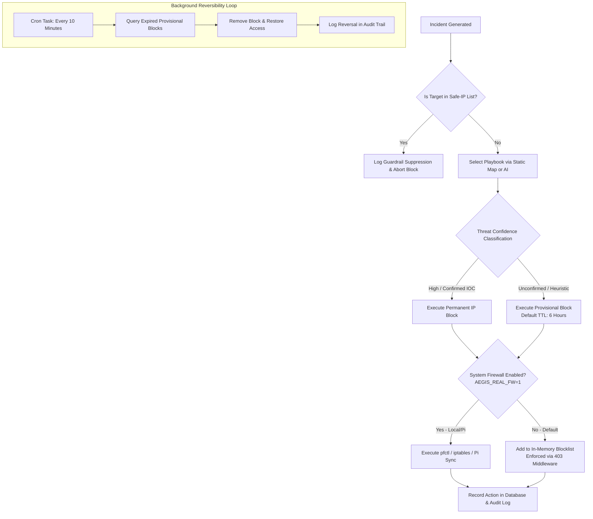
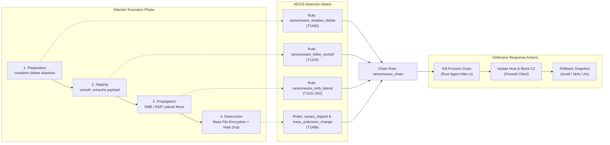
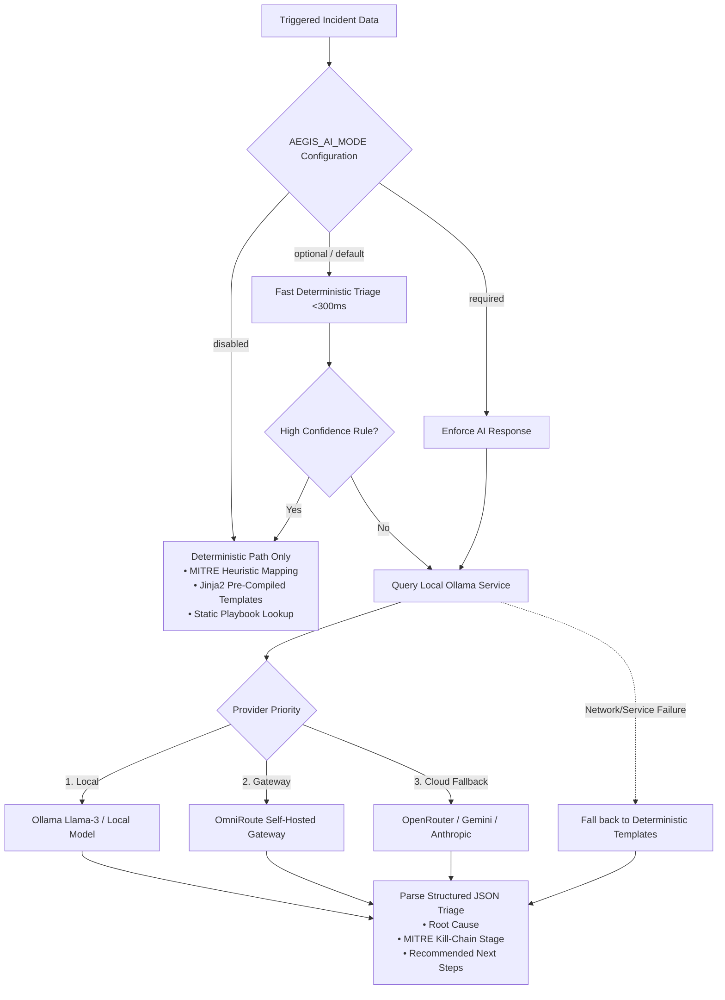
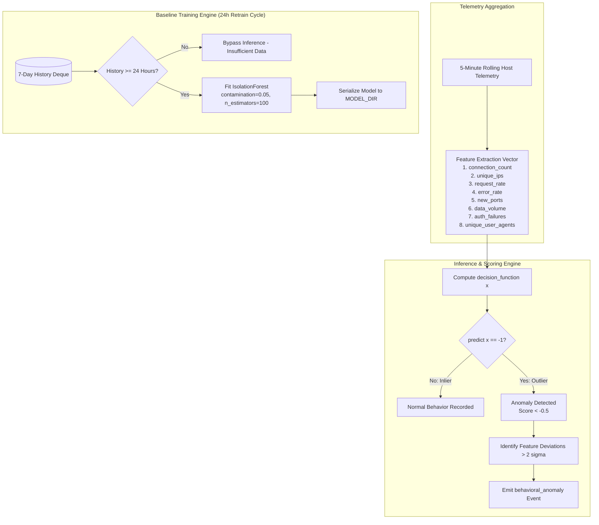

# AEGIS Architecture & Technical Diagrams

This document contains high-fidelity Mermaid diagrams detailing the architecture, telemetry flows, detection engines, response mechanisms, and AI workflows implemented in the AEGIS platform.

---

## Figure 1: Overall AEGIS Architecture

---

## Figure 2: Endpoint Telemetry Pipeline

---

## Figure 3: Threat Detection Pipeline

---

## Figure 4: Event Correlation & Chain Detection

---

## Figure 5: Automated Response (SOAR) Workflow

---

## Figure 6: Multi-Stage Ransomware Kill-Chain Detection & Response

---

## Figure 7: AI-Assisted Incident Triage (Offline vs Cloud)

---

## Figure 8: Behavioral ML Anomaly Detection Workflow

